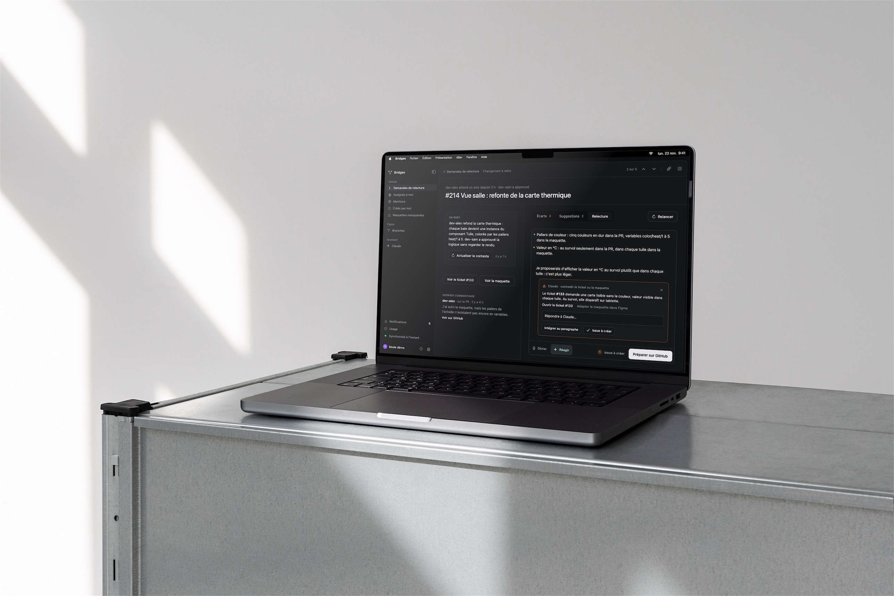

# Bridges

[Version française](README.md)

Demo mode of the app: sample data.

Bridges is a macOS app for product designers. It connects Figma mockups to the development work tracked
on GitHub and relies on Claude to prepare each task. Everything is set up in the app: no account, repository, or
file is written into the code.

**[Download Bridges](https://github.com/Perceval-exe/Bridges/releases/latest/download/Bridges.dmg)** (`Bridges.dmg`) ·
macOS 27, Mac with Apple silicon · app signed and notarized by Apple.

## Main features

Each item opens in a detail view specific to the task. On a wide screen, it splits into two columns: on the left,
the context written by Claude (started on request) and Claude’s feedback; on the right, the designer’s notes area.

| Screen | Goal | Claude’s analysis, on request |
|---|---|---|
| Review requests | Give a design review on a PR | Review preparation: what the PR changes, points to check, screens to compare, and test build. “Comparison” tab: a full account of the differences with the mockup, screen by screen, each difference stating whether it was seen in the test build or read in the code. No verdict and no written comment: the review stays the designer’s |
| Assigned to me | Identify the expected deliverable | Ticket summary, deliverables, Figma screens involved, points to check, branch to create, then mockup update by conversation |
| Mentions | Answer a request | Context of the exchange and points to clarify before answering; the reply is written by the designer |
| Created by me | Track a ticket | Progress, schedule (milestone, due date, sprint), and remaining work |
| Missing mockups | Step in on development without a mockup | Developer involved, screens to design, level of urgency. Tickets are grouped by need for a mockup, with supporting evidence |
| Figma branches | Merge without risk | Points to check, risks, scope check (off-subject changes, conflicts with the main file). A branch is ready to merge as soon as its design is approved, without waiting for development |
| Claude | Talk with Claude | Conversations grouped by ticket, PR, branch, or mockup; they can be resumed in Terminal |

The app also includes notifications (in the app and in macOS), the history of exchanges on each item,
a command palette (⌘K), a collapsible sidebar (⌃⌘S), and a demo mode (Settings › General).

### Designer’s notes

- **One notes area per item** (review, reply to a mention, design notes, merge notes), saved on the
  Mac at every keystroke; undo (⌘Z) is kept when changing screens. Always shown next to the context: the
  rule that separates them can be dragged to give more room to one or the other (double-click: original width).
- **Dictation**: voice transcription in French, on the Mac when macOS allows it; it continues during navigation in
  the app, with a permanent indicator. Microphone access is requested only the first time dictation is started.
- **Claude’s help with notes**: tidying up, formatting for GitHub, checking the remarks (ticket, code, mockup),
  identifying the points not covered, translating into English. Claude works on the designer’s text without adding an opinion;
  its feedback appears in the “Claude’s feedback” tab.
- **Discussion**: on a wide screen, the “Discussion” tab, next to the notes, opens the conversation with Claude about the item
  without hiding the context. The last tab chosen is kept from one item to the next; the discussion can be expanded or
  continued in Terminal. In demo mode, no question is sent to Claude.

## How Claude works

Bridges uses Claude Code, installed on the Mac, with the account signed in there. Analyses count against the Claude
subscription in the same way as direct use: no API key and no separate billing.

**Principle**: Claude prepares. The designer decides. Claude reads the code and the mockup without seeing the rendered UI; in a few lines, it flags the points
to check (context, screens to compare, leads), with neither a verdict nor ready-to-post text (comment, reply), either of which would steer
the review given under the designer’s name.

- **Subscription only**: any API key present in the environment is ignored; analyses stop if Claude Code
  is not using a subscription.
- **Read-only**: Claude consults GitHub and Figma without ever commenting, assigning, or merging. MCP connectors and
  Claude in Chrome are used only if they are allowed in Settings › Connectors.
- **Analyses on request**: Claude analyzes an item only when the analysis is started from its detail view; no call is
  made automatically. The analysis is kept and shown again at each opening; if the item has changed since (comment,
  commit, ticket edit), Bridges offers to update it.
- **Usage control**: at most two analyses in parallel, paused when the limit is reached. Haiku handles
  short analyses, Sonnet handles reviews; the model can be set per use (Settings › Claude), with the usage of each.
- **Multiple accounts** (for example a work account and a personal account): automatic switch when the
  five-hour session is used up.
- **Usage tracking**: usage for the session and the week, shown in the sidebar.

## Features

### Tracking and priorities

- **Required actions** (Claude screen): operations needed for analyses to continue, such as switching accounts,
  reconnecting, connecting to Figma, or rerunning an analysis. Only blocking actions trigger a macOS notification.
- **Available analyses**: analyses and agent input that are finished and not yet read.
- **Notifications**: reserved for team activity (review requested, mention, assignment, development without a mockup).
- **Branches behind the main file**: each Figma branch shows “Main file updated” when the main file
  has received changes that the branch has not yet picked up (number of screens, pages involved, screens edited on both sides),
  with the steps to follow before working on it again. The calculation uses the Figma API in read-only mode, without Claude.
- **Other tickets on the same screens**: a ticket or a PR flags the other unshipped tickets whose Figma links target
  the same screen (strong signal) or the same section (discreet signal), and states whether the dependency is already noted on the ticket.
  The order of development remains a team decision.
- **Broken Figma links**: links in tickets that no longer lead to any screen in the main file are flagged.
- **Missing mockups grouped by need for a mockup**: among tickets in development without a mockup, Bridges looks for evidence.
  First, “UI developed without a mockup”: the PR creates or tweaks UI files (screens, components, styles,
  copy), the largest jobs first. Then “Probably needs a mockup”: a design label, or the title or description,
  mentions UI. Only these two groups count as missing mockups and trigger a notification. The rest is kept
  apart with the reason: “To check” (no clue), “Bug fixes” (the mockup probably already exists), and
  “Probably no impact on the UI” (server, configuration, tests, technical title). “This is a missing mockup”
  moves a ticket back to the top. At the bottom of the screen, Bridges says how many tickets it examined and which ones it left aside.
- **Snooze**: an item can be removed from its list for one hour, three hours, until 9 a.m. the next day, or until the
  following Monday; it comes back at the scheduled time, with a macOS notification, even if the app is closed.
- **Trash per screen**: dismissed or deleted items are kept for thirty days in the trash of their screen;
  each action can be undone immediately.

### Specialized agents

Agents complement Claude’s analysis with targeted expertise. They use the Claude Code subagent format.
Seven agents are provided (mockup fidelity, Figma merge, scoping, flows and states, accessibility, design system,
UX writing) and can be edited; new agents can be created in the app, with proposed instructions
written by Claude.

- **Agents by section** (Agents screen › By section): each section (reviews, tickets, mentions, missing mockups, branches) has
  its agents, two by default. They are consulted at each analysis in the section; what each one adds to Claude’s analysis is
  shown separately, under “What the agents add,” with no verdict.

- **Import**: `.md` files, a folder, or a GitHub repository (including a private one, if GitHub CLI has access to it).
- **Manual sync** of a repository: summary of the changes, line-by-line detail, and explanation by Claude.
  No change is applied without approval.

### Reference design system

Settings › Tracking accepts a Figma library (published components and styles), a Storybook, a token file (JSON, JSON5,
CSS, including in a private GitHub repository), or documentation. Claude checks the exact name of each component, variant, and token
cited, and flags departures from the design system: hard-coded value, recreated component, nonexistent variant.

### Accessibility

Settings › Accessibility gives access to the following settings:

- **Contrast**: Standard, with a ratio of at least 4.5:1 for all text (WCAG AA), or Enhanced, with a ratio of at
  least 7:1 (AAA) and stronger rules.
- **Reduce motion**: removes transitions, rotations, and animated highlights.
- **Reduce transparency**: darker background behind the command palette and the update window.
- **Differentiate without color**: state dots take a distinct shape (urgent, to handle, ready).
- **Underline links**: links to GitHub and Figma can be identified regardless of color.
- **Enhanced focus**: thick outline around the item selected with the keyboard.
- **Spaced text** and **text size** (standard, large, extra large).

By default, Bridges applies the macOS accessibility settings. Buttons and fields are 40 px high.

With VoiceOver, each list row (reviews, tickets, branches, conversations, palette results) is read as a
single block and opens like a button; group headers are headings, and collapsible; the divider between the context and
the notes is adjusted with the arrow keys; confirmation messages are announced.

## Installation

**Requirements**

- macOS 27, on a Mac with Apple silicon.
- A Claude subscription (Pro, Max, Team, or Enterprise), a GitHub account (github.com; GitHub Enterprise Server is not
  supported), and a Figma account.
- Figma branches require a paid Figma plan.

**Steps**

1. Download [`Bridges.dmg`](https://github.com/Perceval-exe/Bridges/releases/latest/download/Bridges.dmg) (no GitHub
   account required).
2. Open `Bridges.dmg`: a window shows Bridges and the Applications folder. Drag **Bridges** onto **Applications**,
   then eject the disk image. The app is notarized by Apple: it opens without a macOS warning.
3. On first launch, an assistant sets up the following, one screen each:
   - **Claude Code**, installed and signed in to the subscription;
   - **GitHub CLI**, installed by Bridges if it is missing (official version, GitHub signature verified), then signed in;
   - **the team scope**: organizations or repositories to track, suggested from the GitHub account;
   - **Figma**: read-only personal access token (kept in the keychain) and files to track;
   - optionally: the Figma connector for Claude Code (mockup editing by conversation), notifications, Claude in Chrome.

The assistant is available at any time from the ⌘K palette; Settings › General › Check setup shows the same
checklist.

**Updates**: a new version is published every Monday. Bridges detects it and offers to install it; the installation
happens only if the version is signed by the same developer and notarized by Apple. The [changelog](CHANGELOG.en.md)
details the changes.

**Good to know**

- The Figma API does not allow creating a branch: the branch is created in Figma, and editing goes through the Figma connector
  for Claude Code. Limiting changes to the branch is an instruction given to Claude, not a technical lock.
- Commands run in a terminal (GitHub sign-in, resuming a conversation) use the macOS Terminal app.

## Privacy and data

Settings › Data details the information read by Bridges, the information sent to Claude, and where it is stored
(keychain, `~/Library/Application Support/Bridges`, `~/Library/Caches/Bridges`), and makes it possible to erase everything. No statistics and
no reports are sent to a third party. Settings › About shows the version and produces a diagnostic report to send in case of a
problem (with no token, email address, or ticket content).

## Help

The [help center](https://bridges.works/en/help) answers common questions (installation, connections, Claude,
troubleshooting) and receives feedback, without sign-up. In the app, it opens from the Help menu (⌘?), the command
palette, or Settings › About. If something is blocked: [hello@bridges.works](mailto:hello@bridges.works), with the diagnostic report from
Settings › About (“Copy and email support” button).

---

© 2026 Yann Laplassotte. All rights reserved. Bridges is proprietary software, provided free of charge: it may be used freely,
including for professional work; copying, modifying, adapting, redistributing, and reselling it are
prohibited. See the [license](LICENSE).
