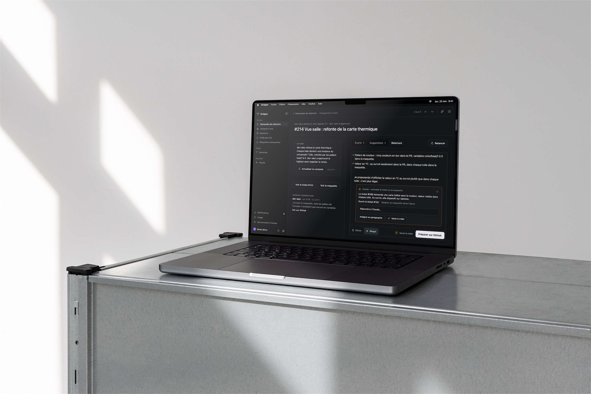

# Bridges

Mode démo de l'application : données fictives.

Bridges est une application macOS destinée aux product designers. Elle relie les maquettes Figma au travail de développement suivi
sur GitHub et s'appuie sur Claude pour préparer chaque tâche. L'ensemble se configure dans l'application : aucun compte, dépôt ni
fichier n'est inscrit dans le code.

**[Télécharger Bridges](https://github.com/Perceval-exe/Bridges/releases/latest/download/Bridges.dmg)** (`Bridges.dmg`) ·
macOS 27, Mac Apple silicon · application signée et notarisée par Apple.

## Fonctions principales

Chaque élément s'ouvre dans une vue détaillée propre à la tâche. Sur un écran large, elle se partage en deux colonnes : à gauche
le contexte rédigé par Claude (lancé sur demande) et les retours de Claude, à droite la zone de notes du designer.

| Écran | Objectif | Analyse de Claude, sur demande |
|---|---|---|
| Accueil | Voir ce qui demande de l'attention | Aucune : chiffres clés, actions du jour classées par urgence, graphiques (demandes reçues sur 14 jours, attente des relectures, avancement des tickets créés, état des branches) et usage du forfait Claude |
| Demandes de relecture | Rendre un avis design sur une PR | Préparation de la relecture : ce que change la PR, pistes à vérifier, écrans à comparer et version de test. Aucun verdict ni commentaire rédigé : l'avis reste celui du designer |
| Assignés à moi | Identifier le livrable attendu | Synthèse du ticket, livrables, écrans Figma concernés, points d'attention, branche à créer, puis mise à jour de la maquette par conversation |
| Mentions | Répondre à une sollicitation | Contexte de l'échange et points à clarifier avant de répondre ; la réponse est rédigée par le designer |
| Créés par moi | Suivre un ticket | Avancement, planning (jalon, échéance, sprint) et travail restant |
| Anomalies | Intervenir sur un développement sans maquette | Développeur concerné, écrans à concevoir, niveau d'urgence. Les tickets sont rangés par besoin de maquette, preuve à l'appui |
| Branches Figma | Fusionner sans risque | Points à contrôler, risques, contrôle du périmètre (modifications hors sujet, conflits avec le fichier principal). Une branche est prête à fusionner dès que son design est validé, sans attendre le développement |
| Claude | Échanger avec Claude | Conversations classées par ticket, PR, branche ou maquette ; reprise possible dans le Terminal |

L'application comprend également des notifications (dans l'application et dans macOS), l'historique des échanges sur chaque élément,
une palette de commandes (⌘K), une barre latérale repliable (⌃⌘S) et un mode démo (Réglages › Général).

### Notes du designer

- **Une zone de notes par élément** (relecture, réponse à une mention, notes de conception, notes de merge), enregistrée sur le
  Mac à chaque frappe ; l'annulation (⌘Z) est conservée lors d'un changement d'écran. Ouverte d'office pour les relectures et les
  mentions, repliable ailleurs.
- **Dictée** : transcription vocale en français, sur le Mac lorsque macOS le permet ; elle se poursuit pendant la navigation dans
  l'application, avec un indicateur permanent. L'accès au micro n'est demandé qu'au premier lancement de la dictée.
- **Aide de Claude sur les notes** : formaliser, mettre en forme pour GitHub, vérifier les remarques (ticket, code, maquette),
  identifier les points non couverts, traduire en anglais. Claude travaille sur le texte du designer sans y ajouter d'avis ;
  ses retours s'affichent dans l'onglet « Retours de Claude ».

## Fonctionnement de Claude

Bridges utilise Claude Code, installé sur le Mac, avec le compte qui y est connecté. Les analyses sont décomptées de l'abonnement
Claude au même titre qu'un usage direct : aucune clé API ni facturation séparée.

**Principe** : Claude prépare, le designer juge. Claude lit le code et la maquette sans voir le rendu ; il signale en quelques lignes les points
d'attention (contexte, écrans à comparer, pistes), sans verdict ni texte tout prêt (commentaire, réponse), qui influenceraient
l'avis rendu sous le nom du designer.

- **Abonnement uniquement** : toute clé API présente dans l'environnement est ignorée ; les analyses s'interrompent si Claude Code
  n'utilise pas un abonnement.
- **Lecture seule** : Claude consulte GitHub et Figma sans jamais commenter, assigner ni fusionner. Les connecteurs MCP et
  Claude in Chrome ne sont utilisés que s'ils sont autorisés dans Réglages › Connecteurs.
- **Analyses sur demande** : Claude n'analyse un élément que lorsque l'analyse est lancée depuis sa vue détaillée ; aucun appel n'est
  effectué automatiquement. L'analyse est conservée et réaffichée à chaque ouverture ; si l'élément a changé depuis (commentaire,
  commit, modification du ticket), Bridges propose de la mettre à jour.
- **Maîtrise de la consommation** : deux analyses au plus en parallèle, mise en pause à l'atteinte de la limite. Haiku traite les
  analyses courtes, Sonnet les relectures ; le modèle est réglable par usage (Réglages › Claude), avec la consommation de chacun.
- **Comptes multiples** (par exemple un compte professionnel et un compte personnel) : bascule automatique lorsque la session de
  cinq heures est épuisée.
- **Suivi de l'usage** : consommation de la session et de la semaine, affichée dans la barre latérale.

## Fonctionnalités

### Suivi et priorités

- **Actions requises** (écran Claude) : opérations nécessaires à la poursuite des analyses, telles que le changement de compte,
  la reconnexion, la connexion à Figma ou la relance d'une analyse. Seules les actions bloquantes déclenchent une notification macOS.
- **Analyses disponibles** : analyses et avis d'agents terminés et non encore consultés.
- **Notifications** : réservées à l'activité de l'équipe (relecture demandée, mention, assignation, développement sans maquette).
- **Branches en retard sur le principal** : chaque branche Figma signale « Mise à jour du principal » lorsque le fichier principal
  a reçu des modifications qu'elle n'a pas encore récupérées (nombre d'écrans, pages concernées, écrans modifiés des deux côtés),
  avec les réflexes à suivre avant d'y retravailler. Le calcul utilise l'API Figma en lecture, sans Claude.
- **Autres tickets sur les mêmes écrans** : un ticket ou une PR signale les autres tickets non livrés dont les liens Figma visent
  le même écran (signal marqué) ou la même section (signal discret), et indique si la dépendance est déjà notée sur le ticket.
  L'ordre de développement reste une décision de l'équipe.
- **Liens Figma cassés** : les liens de tickets qui ne mènent plus à aucun écran du fichier principal sont signalés.
- **Anomalies rangées par besoin de maquette** : parmi les tickets en développement sans maquette, Bridges cherche des preuves.
  En tête, « Interface développée sans maquette » : la PR crée ou retouche des fichiers d'interface (écrans, composants, styles,
  textes), les plus gros chantiers d'abord. Puis « Probablement à maquetter » : un libellé de design, le titre ou la description
  parlent d'interface. Seuls ces deux groupes comptent parmi les anomalies et déclenchent une notification. Le reste est rangé
  à part avec la raison : « À vérifier » (aucun indice), « Corrections de bugs » (la maquette existe sans doute déjà) et
  « Probablement sans impact sur l'interface » (serveur, configuration, tests, titre technique). « C'est bien une anomalie »
  remet un ticket en tête. En bas de l'écran, Bridges dit combien de tickets il a examinés et lesquels il a laissés de côté.
- **Rappeler plus tard** : un élément peut être retiré de sa liste pour une heure, trois heures, jusqu'au lendemain 9 h ou au
  lundi suivant ; il revient à l'heure prévue, avec une notification macOS, même si l'application est fermée.
- **Corbeille par écran** : les éléments ignorés ou supprimés sont conservés trente jours dans la corbeille de leur écran ;
  chaque action peut être annulée immédiatement.

### Agents spécialisés

Les agents complètent l'analyse de Claude par une expertise ciblée. Ils utilisent le format des sous-agents de Claude Code.
Sept agents sont fournis (fidélité à la maquette, merge Figma, cadrage, parcours et états, accessibilité, design system,
rédaction) et peuvent être modifiés ; de nouveaux agents peuvent être créés dans l'application, avec une proposition de consignes
rédigée par Claude.

- **Agents par section** (écran Agents › Par section) : chaque section (relectures, tickets, mentions, anomalies, branches) a
  ses agents, deux par défaut. Ils sont consultés à chaque analyse de la section ; ce que chacun apporte en plus de Claude est
  présenté à part, sous « Ce qu'ajoutent les agents », sans verdict.

- **Import** : fichiers `.md`, dossier, ou dépôt GitHub (y compris privé, si GitHub CLI y a accès).
- **Synchronisation manuelle** d'un dépôt : résumé des modifications, détail ligne à ligne et explication par Claude.
  Aucune modification n'est appliquée sans validation.

### Design system de référence

Réglages › Suivi accepte une bibliothèque Figma (composants et styles publiés), un Storybook, un fichier de tokens (JSON, JSON5,
CSS, y compris dans un dépôt GitHub privé) ou une documentation. Claude vérifie le nom exact de chaque composant, variante et token
cité, et signale les écarts au design system : valeur codée en dur, composant recréé, variante inexistante.

### Accessibilité

Réglages › Accessibilité donne accès aux réglages suivants :

- **Contraste** : Standard, avec un rapport d'au moins 4,5:1 pour tous les textes (WCAG AA), ou Renforcé, avec un rapport d'au
  moins 7:1 (AAA) et des filets plus marqués.
- **Réduction des animations** : suppression des transitions, rotations et reflets animés.
- **Liens soulignés** : identification des liens vers GitHub et Figma indépendamment de la couleur.
- **Focus renforcé** : contour épais autour de l'élément sélectionné au clavier.
- **Texte espacé** et **taille du texte** (standard, grand, très grand).

Par défaut, Bridges applique les réglages d'accessibilité de macOS. Les boutons et les champs mesurent 40 px de haut ; chaque ligne
de liste est restituée d'un seul tenant par VoiceOver.

## Installation

**Prérequis**

- macOS 27, sur un Mac Apple silicon.
- Un abonnement Claude (Pro, Max, Team ou Enterprise), un compte GitHub (github.com ; GitHub Enterprise Server n'est pas pris en
  charge) et un compte Figma.
- Les branches Figma nécessitent une offre Figma payante.

**Procédure**

1. Télécharger [`Bridges.dmg`](https://github.com/Perceval-exe/Bridges/releases/latest/download/Bridges.dmg) (aucun compte
   GitHub requis).
2. Ouvrir `Bridges.dmg` : une fenêtre présente Bridges et le dossier Applications. Faire glisser **Bridges** sur **Applications**,
   puis éjecter l'image disque. L'application étant notarisée par Apple, elle s'ouvre sans avertissement.
3. Au premier lancement, un assistant configure les éléments suivants, un par écran :
   - **Claude Code**, installé et connecté à l'abonnement ;
   - **GitHub CLI**, installé par Bridges s'il est absent (version officielle, signature de GitHub vérifiée), puis connecté ;
   - **le périmètre de l'équipe** : organisations ou dépôts à suivre, proposés à partir du compte GitHub ;
   - **Figma** : jeton personnel en lecture seule (conservé dans le trousseau) et fichiers à suivre ;
   - en option : connecteur Figma de Claude Code (modification des maquettes par conversation), notifications, Claude in Chrome.

L'assistant est accessible à tout moment depuis la palette ⌘K ; Réglages › Général › Vérifier la configuration présente la même
liste de contrôle.

**Mises à jour** : une nouvelle version est publiée chaque lundi. Bridges la détecte et propose son installation ; celle-ci n'est
effectuée que si la version est signée par le même développeur et notarisée par Apple. Le [journal des versions](CHANGELOG.md)
détaille les changements.

**Points à connaître**

- L'API Figma ne permet pas de créer de branche : la branche est créée dans Figma, la modification passe par le connecteur Figma
  de Claude Code. La restriction des modifications à la branche est une consigne donnée à Claude, non un verrou technique.
- Les commandes exécutées dans un terminal (connexion GitHub, reprise d'une conversation) utilisent l'application Terminal de macOS.

## Confidentialité et données

Réglages › Données détaille les informations lues par Bridges, celles transmises à Claude et leur emplacement de stockage
(trousseau, `~/Library/Application Support/Bridges`, `~/Library/Caches/Bridges`), et permet de tout effacer. Aucune statistique ni
aucun rapport n'est transmis à un tiers. Réglages › À propos indique la version et produit un diagnostic à transmettre en cas de
problème (sans jeton, adresse e-mail ni contenu de ticket).

---

© 2026 Yann Laplassotte. Tous droits réservés. Bridges est un logiciel propriétaire gratuit : son utilisation est libre, y
compris dans un cadre professionnel ; sa copie, sa modification, son adaptation, sa redistribution et sa revente sont
interdites. Voir la [licence d'utilisation](LICENSE).
